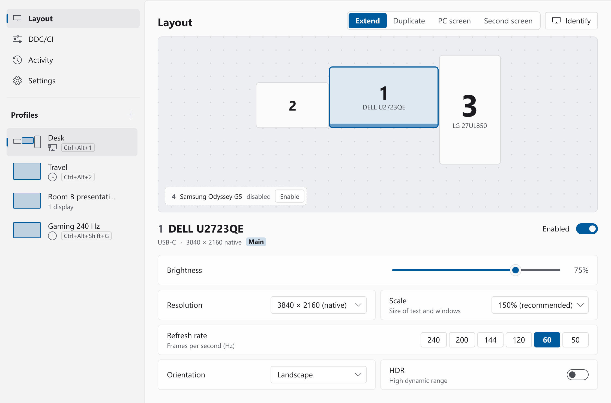
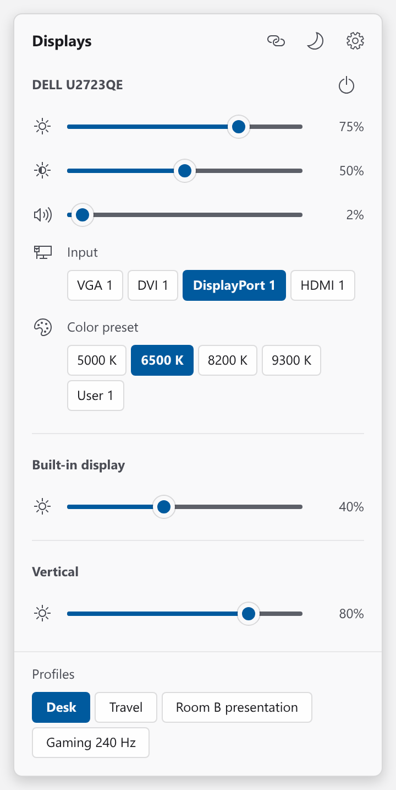
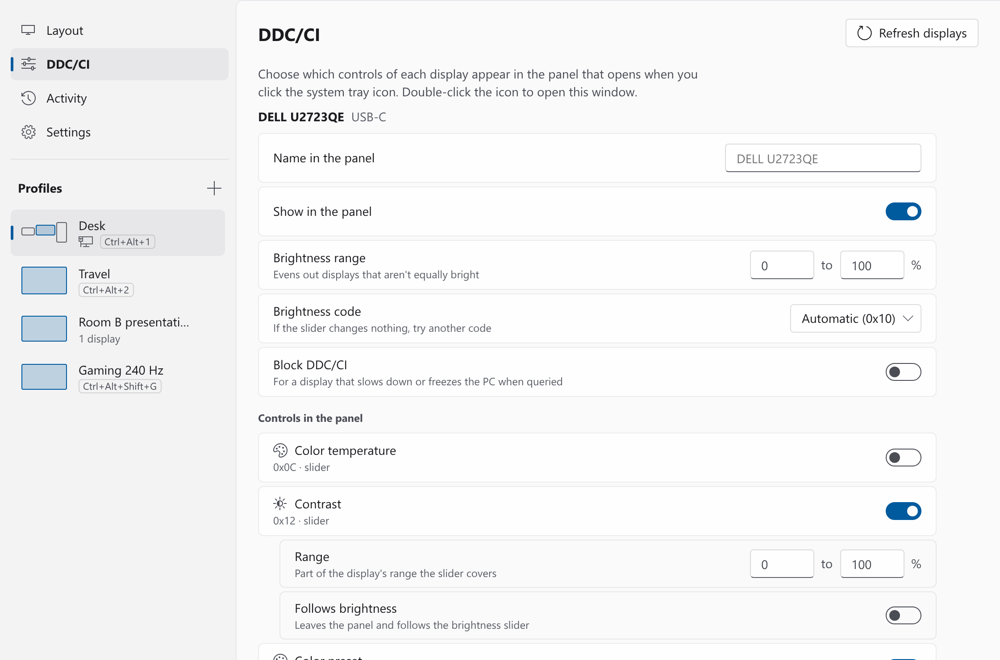

# MonitorMG

[Français](README.md) · **English**

> **Foreword.** MonitorMG was born out of a personal need: controlling my displays on Windows without endless trips through the Settings app. The project is entirely "vibe-coded": its code was written by an AI, under my direction. I therefore don't claim to be the main developer of this tool; I'm sharing it as is, in case it can be useful to others.

Manage your displays on Windows 10 and 11 without going through Settings: enable or disable a display, position it, adjust brightness, resolution, refresh rate, orientation, scaling and HDR. Also drive your displays' DDC/CI controls (contrast, volume, input, color preset, power…) from a panel that opens with one click on the tray icon. Save display profiles and recall them in one click, from the system tray, a keyboard shortcut or a desktop icon.

The interface is available in English and French: it follows the Windows display language (French when Windows is in French, English otherwise). The installer speaks both languages too.

## Overview

The main window: display layout, and for each display brightness, resolution, scaling, refresh rate, orientation and HDR. On the left, profiles and their shortcuts.

<picture>
  <source media="(prefers-color-scheme: dark)" srcset="docs/screenshots/window-en-dark.png">
  
</picture>

The system tray panel, opened with one click on the icon: each display's brightness, the DDC/CI controls you chose (here contrast, volume, input and color preset), turning displays off, and profiles.

<p align="center">
  <picture>
    <source media="(prefers-color-scheme: dark)" srcset="docs/screenshots/flyout-en-dark.png">
    
  </picture>
</p>

The DDC/CI view: what each display says it can do, and which controls to show in the panel.

<picture>
  <source media="(prefers-color-scheme: dark)" srcset="docs/screenshots/ddc-en-dark.png">
  
</picture>

The screenshots are taken from the development preview (`dev/serve.js`), with simulated displays; the interface is the application's own.

## Installation

| Edition | Who it's for | How |
| --- | --- | --- |
| Installer `MonitorMG-2.2.3-setup.exe` | Most users | Double-click it. No administrator rights are requested; MonitorMG installs for your account and appears in the Start menu. |
| Portable `MonitorMG-2.2.3-portable.zip` | USB stick, machine without installation | Unzip into a personal folder and run `MonitorMG.exe`. Profiles and the log stay in the `data` folder next to it. |

Prerequisite: Microsoft Edge WebView2, already present on Windows 11. The installer adds it if needed; for the portable edition, [download it here](https://go.microsoft.com/fwlink/p/?LinkId=2124703).

The `SHA256SUMS.txt` file published with each release lets you check that the downloaded file has not been tampered with.

## Usage

| Where | What |
| --- | --- |
| Layout | Drag a display to move it: it snaps like in Windows. With the keyboard, select it and use the arrow keys. |
| Profiles | Click a profile to apply it; right-click or `⋯` to rename it, give it a keyboard shortcut, create its desktop shortcut, apply it when its displays are connected (ideal with a dock), give it triggers (every day at a set time, when plugged in or on battery, when a program starts) or choose which settings it applies: scaling, HDR and brightness can be left as they are, and the positions of the windows open when it was saved can be restored. |
| DDC/CI | For each display: its name and presence in the panel, its brightness range (to harmonize displays that don't light up the same), the brightness VCP code, DDC/CI blocking. Then the controls announced by the display, to show in the panel: a slider for continuous settings (contrast, volume, gains…), choices for the others (input, color preset, mute), an on/off button. A continuous setting can follow brightness. A code missing from the list can be added by hand. For a display connected to two machines, input switching by shortcut: two inputs and a key combination replace a KVM switch. Finally, the behavior of "Turn displays off": Windows sleep, DDC/CI signal, or both. |
| Activity | The history of every change, wherever it came from (window, menu, shortcut, connection), with **Undo**. |
| Settings | Start with Windows, system tray icon (five to choose from), brightness by time of day (timed steps, with a smooth transition or at once), change confirmation and its delay, shortcuts to turn displays off and to raise or lower brightness plus the brightness step, the list of shortcuts, the data folder, the update check (optional). |
| System tray | Left click: the panel. Each display's brightness (mouse wheel on a slider), a single slider for all of them if you prefer, the DDC/CI controls you chose, an on/off button, profiles, turning displays off. Double click: the window. Right click: profiles, undo, and for each display its brightness (in steps, or the panel for fine adjustment), resolution, refresh rate, enabling and main display; projection, identification, turning displays off. |

A risky change (resolution, refresh rate, orientation, enabling, projection) asks for confirmation: without an answer, the previous display settings come back after 15 s. The delay, from 5 to 60 s, is set in Settings.

### Automations

- **Brightness by time of day** (Settings): add steps, for example 70% at 7:30 AM and 25% at 10:30 PM. All adjustable displays follow them every day, each within its own range; with the smooth transition, brightness glides from one step to the next minute by minute. A manual adjustment stays in place until the next step. DDC/CI controls that follow brightness (color temperature, contrast…) follow the time of day too: a way to warm the picture in the evening, inside the display itself.
- **Profile triggers** (profile menu, "Triggers…"): the profile applies on its own every day at the chosen time, when the PC is plugged in or goes on battery, or when a program starts (its name, like `game.exe`). Each application is recorded in Activity and can be undone like any other. Nothing happens when the program closes, and a time that passed while the PC was asleep is not caught up.
- **Software brightness**: a display that doesn't respond over DDC/CI (some adapters, docks or TVs) keeps a brightness slider. MonitorMG lays a dark veil over it, which clicks go through and which never turns it black. The veil goes away when MonitorMG closes and shows up in screenshots; as soon as the display responds over DDC/CI, hardware brightness takes over.
- **Window positions** (profile menu, "Applied settings…"): a profile remembers the windows open when it was saved. Turn on "Window positions" to have it put them back in place after it is applied; "Replace with current setup" updates them. Windows of a program run as administrator can't be moved.
- **Input switching** (DDC/CI view): pick two inputs of the display and a shortcut. It goes from one to the other, wherever you are in Windows. With MonitorMG on both machines, each one takes the display back with a key combination.

### Keyboard shortcuts

| Shortcut | Action |
| --- | --- |
| One of your choice | Apply a profile, anywhere in Windows |
| One of your choice | Turn displays off, anywhere in Windows; a key press or the mouse turns them back on |
| Ones of your choice | Raise or lower the brightness of all displays |
| One of your choice | Switch a display's input between two sources, anywhere in Windows |
| `Ctrl+S` | Save the current setup as a profile |
| `Ctrl+Z` | Undo the last change |
| `Ctrl+I` | Identify the displays |
| `Ctrl+1` to `Ctrl+9` | Apply profile 1 to 9 |
| `1` to `9` | Select display 1 to 9 |
| Arrow keys | Move the selected display |
| `F5` | Refresh displays |

### Command line

```
MonitorMG.exe --profile <id or name>                     applies a profile
MonitorMG.exe --brightness <0 to 100>                    sets the brightness of all displays
MonitorMG.exe --brightness <0 to 100> --screen <display> sets the brightness of one display
MonitorMG.exe --input <display>                          switches its input between the two picked in the DDC/CI view
MonitorMG.exe --off                                      turns displays off
MonitorMG.exe --json                                     writes the state of displays and profiles, as JSON
MonitorMG.exe --minimized                                starts in the system tray
```

`<display>` is the display's number (the one shown in the window and by "Identify") or its name, in quotes if it contains spaces. A command is passed to MonitorMG if it is already running; otherwise it acts on its own, then the process exits. Each action is recorded in Activity, with the source "Command".

`--json` is meant for scripts: in PowerShell, `MonitorMG.exe --json | ConvertFrom-Json`.

**Stream Deck, Task Scheduler, scripts**: these commands are enough, no plugin needed. On a Stream Deck, the "System: Open" action launches a Windows shortcut: create one whose target is, for example, `MonitorMG.exe --brightness 40`, and drag it into the action's field. Profiles already have theirs (profile menu, "Desktop shortcut").

## Privacy

MonitorMG runs entirely on your computer. It collects no data and needs no administrator rights. It never connects to the Internet, unless you turn on the update check (Settings): it then asks GitHub once a day for the name of the latest version, sending nothing else and downloading nothing. It only writes:

- its profiles, settings and log to `%APPDATA%\MonitorMG` (or `data\` in the portable edition);
- a startup entry in your account's registry, if you enable "Start with Windows".

A profile that remembers window positions stores the name of their program and a fingerprint of their title, never the title itself.

## Troubleshooting

- **An action doesn't do what you expected**: the Activity view shows what happened and why. The full log is in `logs\activite.jsonl`, under the data folder (Settings, "Open folder"). Attach it to your report.
- **Black screen after a change**: wait for the delay to run out, the previous display settings come back on their own. Otherwise, `Ctrl+Z` in the window or "Undo" in the tray menu.
- **A display doesn't appear in the panel, or the DDC/CI view says "Controls unreadable"**: enable DDC/CI in the display's on-screen menu. Some adapters and cables (optical HDMI, cheap docking stations) don't pass it through. If the brightness slider changes nothing, try another brightness code in the DDC/CI view.
- **A display's brightness is labeled "software"**: this display doesn't respond over DDC/CI, so MonitorMG dims it with a veil. Enable DDC/CI in the display's on-screen menu, then "Refresh displays" in the DDC/CI view, to get hardware brightness back.
- **Some windows don't go back in place**: they must be open when the profile is applied, and windows of a program run as administrator can't be moved. A window whose title changed is recognized by its program.
- **Brightness changes on its own**: brightness by time of day is on (Settings). The Activity view shows each applied step, with the source "Schedule".
- **The PC slows down when the panel opens**: block DDC/CI for the offending display in the DDC/CI view.
- **A display turned off over DDC/CI doesn't turn back on from MonitorMG**: some displays disappear from Windows once turned off. Turn it back on with its button, or choose the "Standby" signal in the DDC/CI view.
- **Two displays of the same model** (a dock with two identical displays): MonitorMG appends their number to their name, "HP E24 (1)" and "HP E24 (2)". The DDC/CI view lets you give them a more telling name.
- **MonitorMG and another DDC/CI tool (Twinkle Tray, Monitorian…) at the same time**: they fight over the displays' bus and correct each other. Keep only one.
- **The window doesn't open**: a message offers to install WebView2.
- **SmartScreen warning during installation**: the executable is not signed yet. Click "More info", then "Run anyway".

## Uninstalling

Windows Settings, Apps, MonitorMG, Uninstall. The Windows startup entry is removed; check "Delete the application data" to also erase your profiles and the log. The portable edition is removed by deleting its folder.

## Acknowledgements

The DDC/CI controls and the panel of version 2.0 are inspired by [Twinkle Tray](https://github.com/xanderfrangos/twinkle-tray), by Xander Frangos (MIT license). No code is taken from it.

## License

MonitorMG is free software, distributed under the [MIT license](LICENSE): you may use, modify and redistribute it, including commercially, provided you keep the copyright notice and the license text. It is provided without any warranty. The authoritative text is in English, in the `LICENSE` file.

## Development

See [docs/DEVELOPPEMENT.md](docs/DEVELOPPEMENT.md), and [docs/AUDIT.md](docs/AUDIT.md) for the version 1.0 audit (both in French).
