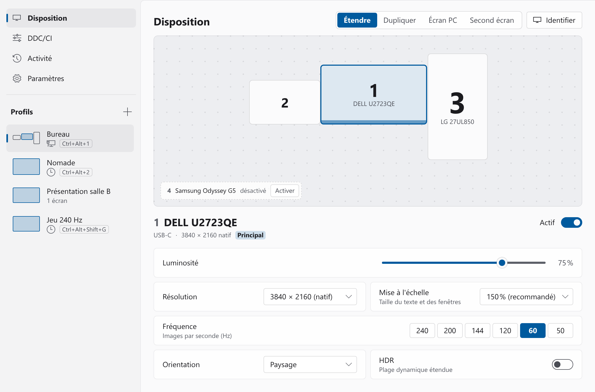
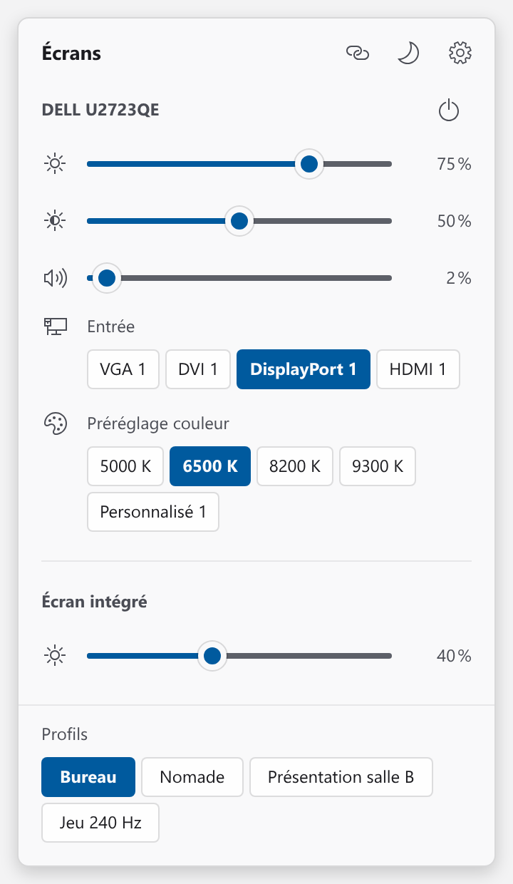
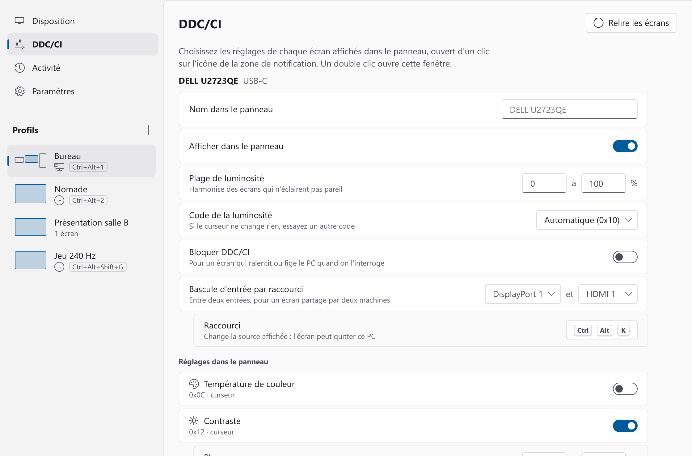

# MonitorMG

**Français** · [English](README.en.md)

> **Avant-propos.** MonitorMG est né d'un besoin personnel : piloter mes écrans sous Windows sans multiplier les allers-retours dans les Paramètres. Le projet est entièrement « vibe-codé » : son code a été écrit par une IA, sous ma direction. Je ne prétends donc pas être le développeur principal de cet outil ; je le partage tel quel, au cas où il rendrait service à d'autres.

Gérez vos écrans sous Windows 10 et 11 sans passer par les Paramètres : activez ou désactivez un écran, placez-le, réglez luminosité, résolution, fréquence, orientation, mise à l'échelle et HDR. Pilotez aussi les commandes DDC/CI de vos écrans (contraste, volume, entrée, préréglage couleur, alimentation…) depuis un panneau ouvert d'un clic sur l'icône de notification. Enregistrez des profils d'affichage et rappelez-les en un clic, depuis la zone de notification, un raccourci clavier ou une icône sur le bureau.

## Aperçu

La fenêtre principale : disposition des écrans, et pour chacun luminosité, résolution, mise à l'échelle, fréquence, orientation et HDR. À gauche, les profils et leurs raccourcis.

<picture>
  <source media="(prefers-color-scheme: dark)" srcset="docs/screenshots/window-fr-dark.png">
  
</picture>

Le panneau de la zone de notification, ouvert d'un clic sur l'icône : luminosité de chaque écran, réglages DDC/CI choisis (ici contraste, volume, entrée et préréglage couleur), extinction des écrans et profils.

<p align="center">
  <picture>
    <source media="(prefers-color-scheme: dark)" srcset="docs/screenshots/flyout-fr-dark.png">
    
  </picture>
</p>

La vue DDC/CI : ce que chaque écran annonce savoir faire, et les réglages à afficher dans le panneau.

<picture>
  <source media="(prefers-color-scheme: dark)" srcset="docs/screenshots/ddc-fr-dark.png">
  
</picture>

Les captures sont prises sur l'aperçu de développement (`dev/serve.js`), avec des écrans simulés ; l'interface est celle de l'application.

## Installation

| Édition | Pour qui | Comment |
| --- | --- | --- |
| Installateur `MonitorMG-2.3.0-setup.exe` | La plupart des utilisateurs | Double-cliquez. Aucun droit administrateur n'est demandé ; MonitorMG s'installe pour votre compte et apparaît dans le menu Démarrer. |
| Portable `MonitorMG-2.3.0-portable.zip` | Clé USB, poste sans installation | Décompressez dans un dossier personnel et lancez `MonitorMG.exe`. Profils et journal restent dans le dossier `data`, à côté. |

Prérequis : Microsoft Edge WebView2, déjà présent sur Windows 11. L'installateur l'ajoute si besoin ; pour l'édition portable, [téléchargez-le ici](https://go.microsoft.com/fwlink/p/?LinkId=2124703).

Le fichier `SHA256SUMS.txt` publié avec chaque version permet de vérifier que le fichier téléchargé n'a pas été modifié.

## Utilisation

| Où | Quoi |
| --- | --- |
| Disposition | Glissez un écran pour le déplacer : il s'aimante comme dans Windows. Au clavier, sélectionnez-le et utilisez les flèches. |
| Profils | Cliquez un profil pour l'appliquer ; clic droit ou `⋯` pour le renommer, lui donner un raccourci clavier, créer son raccourci sur le bureau, l'appliquer au branchement de ses écrans (idéal avec un dock), lui donner des déclencheurs (chaque jour à heure fixe, au passage sur secteur ou sur batterie, au lancement d'un programme) ou choisir les réglages qu'il applique : mise à l'échelle, HDR et luminosité peuvent être laissés tels quels, et la place des fenêtres ouvertes à son enregistrement peut être rétablie. |
| DDC/CI | Pour chaque écran : nom et présence dans le panneau, plage de luminosité (pour harmoniser des écrans différents), code VCP de la luminosité, blocage de DDC/CI. Puis les commandes annoncées par l'écran, à afficher dans le panneau : un curseur pour les réglages continus (contraste, volume, gains…), des choix pour les autres (entrée, préréglage couleur, sourdine), un bouton marche/arrêt. Un réglage continu peut suivre la luminosité. Un code absent de la liste peut être ajouté à la main. Pour un écran branché à deux machines, la bascule d'entrée par raccourci : deux entrées et une combinaison de touches remplacent un boîtier KVM. Enfin, le comportement de « Éteindre les écrans » : veille de Windows, signal DDC/CI, ou les deux. |
| Activité | L'historique de chaque changement, d'où qu'il vienne (fenêtre, menu, raccourci, branchement), avec **Annuler**. |
| Paramètres | Lancement avec Windows, icône de la zone de notification (cinq au choix), luminosité selon l'heure (des étapes horaires, en transition douce ou par paliers), confirmation des changements et son délai, raccourcis pour éteindre les écrans, monter ou baisser la luminosité et le pas de luminosité, liste des raccourcis, dossier des données, mises à jour (vérification, téléchargement et installation, chacun automatique ou non ; installation silencieuse ; données gardées ou non). |
| Zone de notification | Clic gauche : le panneau. Luminosité de chaque écran (molette sur un curseur), un seul curseur pour tous si vous le souhaitez, réglages DDC/CI choisis, bouton marche/arrêt, profils, extinction des écrans. Double clic : la fenêtre. Clic droit : profils, annulation, et pour chaque écran la luminosité (paliers, ou le panneau pour le réglage précis), la résolution, la fréquence, l'activation et l'écran principal ; projection, identification, extinction des écrans. |

Un changement risqué (résolution, fréquence, orientation, activation, projection) demande confirmation : sans réponse, l'affichage précédent revient au bout de 15 s. Le délai, de 5 à 60 s, se règle dans Paramètres.

### Automatismes

- **Luminosité selon l'heure** (Paramètres) : ajoutez des étapes, par exemple 70 % à 7 h 30 et 25 % à 22 h 30. Tous les écrans réglables les suivent chaque jour, chacun dans sa plage ; en transition douce, la luminosité glisse d'une étape à la suivante minute après minute. Un réglage manuel reste en place jusqu'à l'étape suivante. Les réglages DDC/CI qui suivent la luminosité (température de couleur, contraste…) suivent aussi l'heure : de quoi réchauffer l'image le soir, dans l'écran lui-même.
- **Déclencheurs de profils** (menu du profil, « Déclencheurs… ») : le profil s'applique seul chaque jour à l'heure choisie, au passage sur secteur ou sur batterie, ou au lancement d'un programme (son nom, comme `jeu.exe`). Chaque application est consignée dans l'activité et s'annule comme les autres. Rien ne se passe à la fermeture du programme, et une heure passée pendant la veille du PC n'est pas rattrapée.
- **Luminosité logicielle** : un écran qui ne répond pas en DDC/CI (certains adaptateurs, docks ou téléviseurs) garde un curseur de luminosité. MonitorMG pose sur lui un voile sombre, traversé par les clics, qui ne le rend jamais noir. Ce voile disparaît quand MonitorMG se ferme et apparaît sur les captures d'écran ; dès que l'écran répond en DDC/CI, la luminosité matérielle reprend la main.
- **Place des fenêtres** (menu du profil, « Réglages appliqués… ») : un profil mémorise les fenêtres ouvertes à son enregistrement. Activez « Place des fenêtres » pour qu'il les remette à leur place après son application ; « Remplacer par l'affichage actuel » les met à jour. Les fenêtres d'un programme lancé en administrateur ne peuvent pas être déplacées.
- **Bascule d'entrée** (vue DDC/CI) : choisissez deux entrées de l'écran et un raccourci. Il passe de l'une à l'autre, où que vous soyez dans Windows. Avec MonitorMG sur les deux machines, chacune reprend l'écran d'une combinaison de touches.

### Raccourcis clavier

| Raccourci | Action |
| --- | --- |
| Celui de votre choix | Appliquer un profil, partout dans Windows |
| Celui de votre choix | Éteindre les écrans, partout dans Windows ; une touche ou la souris les rallume |
| Ceux de votre choix | Monter ou baisser la luminosité de tous les écrans |
| Celui de votre choix | Basculer l'entrée d'un écran entre deux sources, partout dans Windows |
| `Ctrl+S` | Enregistrer l'affichage actuel comme profil |
| `Ctrl+Z` | Annuler la dernière modification |
| `Ctrl+I` | Identifier les écrans |
| `Ctrl+1` à `Ctrl+9` | Appliquer le profil 1 à 9 |
| `1` à `9` | Choisir l'écran 1 à 9 |
| Flèches | Déplacer l'écran sélectionné |
| `F5` | Relire les écrans |

### Ligne de commande

```
MonitorMG.exe --profile <id ou nom>                   applique un profil
MonitorMG.exe --brightness <0 à 100>                  règle la luminosité de tous les écrans
MonitorMG.exe --brightness <0 à 100> --screen <écran> règle celle d'un écran
MonitorMG.exe --input <écran>                         bascule son entrée entre les deux choisies dans la vue DDC/CI
MonitorMG.exe --off                                   éteint les écrans
MonitorMG.exe --json                                  écrit l'état des écrans et des profils, en JSON
MonitorMG.exe --minimized                             démarre dans la zone de notification
```

`<écran>` est le numéro de l'écran (celui de la fenêtre et de « Identifier ») ou son nom, entre guillemets s'il contient des espaces. Une commande est transmise à MonitorMG s'il tourne déjà ; sinon elle agit seule, puis le processus quitte. Chaque action est consignée dans l'activité, source « Commande ».

`--json` est fait pour un script : dans PowerShell, `MonitorMG.exe --json | ConvertFrom-Json`.

**Stream Deck, Planificateur de tâches, scripts** : ces commandes suffisent, sans greffon. Sur un Stream Deck, l'action « Système : Ouvrir » lance un raccourci Windows : créez-en un dont la cible est, par exemple, `MonitorMG.exe --brightness 40`, et glissez-le dans le champ de l'action. Les profils ont déjà le leur (menu du profil, « Raccourci sur le bureau »).

## Confidentialité

MonitorMG fonctionne entièrement sur votre ordinateur. Il ne collecte aucune donnée et n'a besoin d'aucun droit administrateur. Il ne se connecte jamais à Internet, sauf si vous activez la vérification des mises à jour (Paramètres) ou la lancez vous-même : il demande alors une fois par jour à GitHub le nom de la dernière version, sans rien envoyer d'autre. Une nouvelle version n'est téléchargée que si vous le demandez ou l'avez réglé ainsi, depuis la page de la release sur GitHub, et n'est installée qu'après vérification de son empreinte SHA-256. Il écrit uniquement :

- ses profils, réglages et son journal dans `%APPDATA%\MonitorMG` (ou `data\` en édition portable) ;
- une entrée de démarrage dans le registre de votre compte, si vous activez « Lancer avec Windows ».

Un profil qui mémorise la place des fenêtres enregistre le nom de leur programme et une empreinte de leur titre, jamais le titre lui-même.

## Dépannage

- **Une action ne fait pas ce qui est attendu** : la vue Activité indique ce qui s'est passé et pourquoi. Le journal complet est dans `logs\activite.jsonl`, sous le dossier des données (Paramètres, « Ouvrir le dossier »). Joignez-le à votre signalement.
- **Écran noir après un changement** : attendez la fin du délai, l'affichage précédent revient seul. Sinon, `Ctrl+Z` dans la fenêtre ou « Annuler » dans le menu de notification.
- **Un écran n'apparaît pas dans le panneau, ou la vue DDC/CI dit « Commandes illisibles »** : activez DDC/CI dans le menu de l'écran. Certains adaptateurs et câbles (HDMI optique, stations d'accueil bon marché) ne le transmettent pas. Si le curseur de luminosité ne change rien, essayez un autre code de luminosité dans la vue DDC/CI.
- **La luminosité d'un écran est dite « logicielle »** : cet écran ne répond pas en DDC/CI, MonitorMG l'assombrit par un voile. Activez DDC/CI dans le menu de l'écran, puis « Relire les écrans » dans la vue DDC/CI, pour retrouver la luminosité matérielle.
- **Des fenêtres ne reviennent pas à leur place** : elles doivent être ouvertes quand le profil s'applique, et celles d'un programme lancé en administrateur ne peuvent pas être déplacées. Une fenêtre dont le titre a changé est reconnue par son programme.
- **La luminosité change toute seule** : la luminosité selon l'heure est active (Paramètres). La vue Activité montre chaque étape appliquée, source « Planification ».
- **Le PC ralentit quand le panneau s'ouvre** : bloquez DDC/CI pour l'écran en cause dans la vue DDC/CI.
- **Un écran éteint par DDC/CI ne se rallume pas depuis MonitorMG** : certains écrans disparaissent de Windows une fois éteints. Rallumez-le avec son bouton, ou choisissez le signal « Veille » dans la vue DDC/CI.
- **Deux écrans du même modèle** (dock avec deux écrans identiques) : MonitorMG ajoute leur numéro à leur nom, « HP E24 (1) » et « HP E24 (2) ». La vue DDC/CI permet de leur donner un nom plus parlant.
- **MonitorMG et un autre logiciel DDC/CI (Twinkle Tray, Monitorian…) en même temps** : ils se disputent le bus des écrans et se corrigent l'un l'autre. Gardez-en un seul.
- **La fenêtre ne s'ouvre pas** : un message propose d'installer WebView2.
- **Avertissement SmartScreen à l'installation** : l'exécutable n'est pas encore signé. Cliquez sur « Informations complémentaires », puis « Exécuter quand même ».

## Désinstallation

Paramètres de Windows, Applications, MonitorMG, Désinstaller. Le lancement avec Windows est retiré ; cochez « Supprimer les données de l'application » pour effacer aussi vos profils et le journal. L'édition portable se supprime avec son dossier.

## Remerciements

Les commandes DDC/CI et le panneau de la version 2.0 s'inspirent de [Twinkle Tray](https://github.com/xanderfrangos/twinkle-tray), de Xander Frangos (licence MIT). Aucun code n'en est repris.

## Licence

MonitorMG est un logiciel libre, distribué sous [licence MIT](LICENSE) : vous pouvez l'utiliser, le modifier et le redistribuer, y compris à des fins commerciales, à condition de conserver la mention de copyright et le texte de la licence. Il est fourni sans aucune garantie. Le texte qui fait foi est en anglais, dans le fichier `LICENSE`.

## Développement

Voir [docs/DEVELOPPEMENT.md](docs/DEVELOPPEMENT.md), et [docs/AUDIT.md](docs/AUDIT.md) pour l'audit de la version 1.0.
